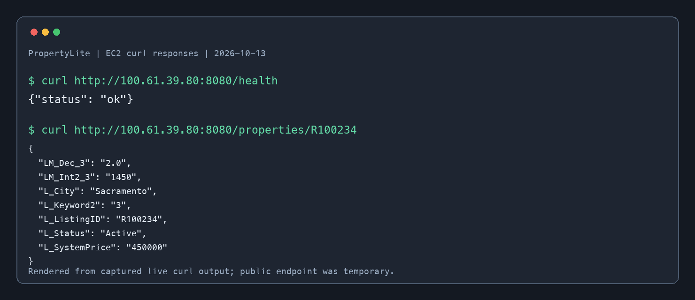

# Week 3 evidence — 2026-10-13

| Check | Observed result |
|---|---|
| EC2 instance | `i-09d96f36d5998d089` reached `running` in `us-east-1` |
| API service | `systemctl is-active property-api` returned `active`; `is-enabled` returned `enabled` |
| `GET /health` | `{"status":"ok"}` |
| `GET /properties/R100234` | Returned the Sacramento sample listing with `L_ListingID: R100234`, three bedrooms, and price `450000` |
| Root EBS volume | `vol-0ae80be5d8f04982c` attached at `/dev/xvda`, with delete-on-termination enabled |
| Manual snapshot | `snap-01c25679b415c8517` reached `completed` at `100%` |

The image above was rendered from the actual curl response bodies captured while the temporary EC2 endpoint was live. It is labeled as rendered evidence rather than a literal screenshot of the terminal. The source responses were validated as JSON.

## Teardown verification

After the Week 4 database work, EC2 reported `terminated`. The root EBS volume, manual snapshot, EC2 security group, key pair, and local PEM file all returned absent in the final checks. The temporary public API endpoint is no longer running.
